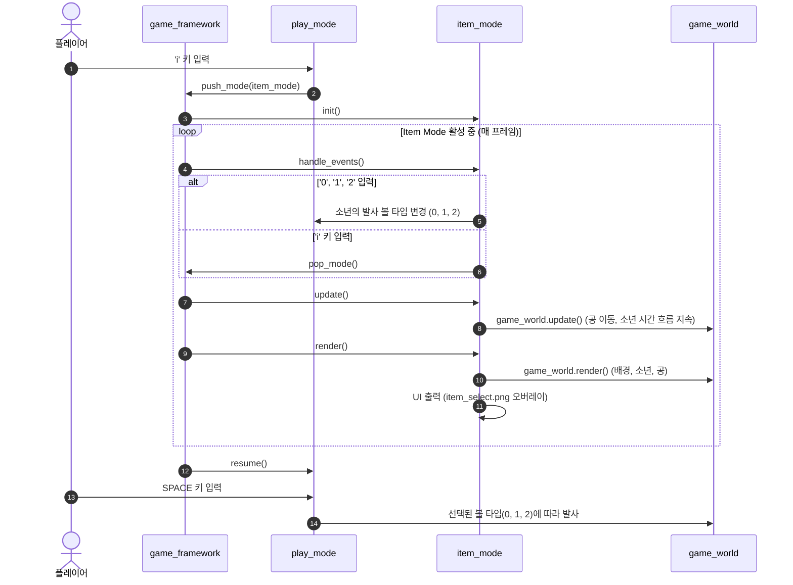

# PRD — 아이템 선택 모드(Item Mode) 구현 (DRILL_13)

## 1. 개요

본 프로젝트는 pico2d 기반 2D 게임 프레임워크 상에서 **아이템 선택 모드(`item_mode`)**를 구현하는 과제이다.
플레이어가 게임 진행 중 `i` 키를 눌러 아이템 선택 창을 띄우고, 발사할 투사체(공)의 종류를 실시간으로 변경할 수 있도록 한다.
특히, 아이템 선택 창이 열려 있는 동안에도 게임 화면이 멈추지 않고(Non-pausing), 이미 발사된 공들과 주인공 캐릭터가 시간의 흐름에 맞춰 정상 동작하도록 구현한다.

- **프로젝트 명** : 2DGP DRILL_13 (Item Mode)
- **개발 언어 및 라이브러리** : Python 3.12, pico2d, transitions
- **실행 진입점** : `python main.py`
- **종료 조건** : 창 닫기(SDL_QUIT) 또는 타이틀/플레이 화면에서 `ESC`
- **버전 관리 규칙** :
  - 최소 20개 이상의 단계별 커밋 진행
  - 명확하고 직관적인 한글 커밋 메시지 작성
  - 최종 검토 후 사용자가 직접 원격 저장소(`origin/main`)로 Push 수행

---

## 2. 기존 시스템 분석

### 2.1 게임 프레임워크 (`game_framework.py`)
- 스택 기반 모드 관리자(`stack`)
- `push_mode(mode)`, `pop_mode()`, `change_mode(mode)` 제공
- 메인 루프에서 현재 최상위 모드(`stack[-1]`)의 `handle_events()`, `update()`, `render()`를 호출

### 2.2 기존 플레이 모드 및 오브젝트
- `play_mode.py`: `boy`(레이어 1), `grass`(레이어 0) 생성 및 이벤트/업데이트/렌더링 총괄
- `boy.py`: `transitions`를 활용한 상태 머신(IDLE, SLEEP, RUN) 구현. SPACE 키 입력 시 `fire_ball()` 호출
- `ball.py`: 현재 기본공(`ball21x21.png`, 21x21) 단일 객체만 발사 처리
- `pause_mode.py`: `p` 키 입력 시 게임 월드 업데이트를 멈추는 일시정지 모드

---

## 3. 기능 요구사항

### 3.1 아이템 모드 진입 및 해제
1. `play_mode` 진행 중 `i` 키를 누르면 `item_mode`로 진입(`push_mode`)한다.
2. `item_mode` 화면에서 다시 `i` 키를 누르면 모드가 종료(`pop_mode`)되어 `play_mode`로 복귀한다.

### 3.2 비정지(Non-pausing) 백그라운드 월드 동작
1. 아이템 모드 창이 열려 있는 상태에서도 기존 월드는 정지하지 않는다.
2. 이미 공중에 발사된 공들은 자신의 속도에 따라 계속 날아가고 화면 밖으로 나가면 정상 제거된다.
3. 주인공(Boy)은 시간의 흐름에 따라 애니메이션 프레임이 갱신되며, IDLE 상태에서 5초가 경과하면 SLEEP 상태로 전이되는 등 자연스러운 동작을 유지한다.
4. 단, 아이템 창이 열려 있는 동안 방향키/스페이스바 등의 플레이 조작은 아이템 모드에 의해 차단되며, 아이템 선택 키(`0`, `1`, `2`)와 모드 종료 키(`i`)만 입력받는다.

### 3.3 아이템 선택 UI 및 종류
1. `item_mode` 활성화 시 화면 중앙에 `item_select.png`(272x215) UI 이미지를 오버레이 형태로 렌더링한다.
2. 숫자 키보드 입력을 통해 발사할 공의 종류를 선택한다:
   - **`0` 키** : 공 없음 (SPACE 키를 눌러도 아무것도 발사되지 않음)
   - **`1` 키** : 기본 공 (`ball21x21.png`, 21x21 크기)
   - **`2` 키** : 큰 공 (`ball41x41.png`, 41x41 크기)
3. 선택된 아이템 정보는 소년 캐릭터 또는 공유 상태에 저장되어 모드를 빠져나간 이후에도 유지된다.

### 3.4 투사체(공) 발사 로직 연동
1. `play_mode`에서 SPACE 키를 누르면 현재 선택된 볼 타입에 따라 투사체를 발사한다.
   - 타입 0: 발사 생략
   - 타입 1: 기본 공(`ball21x21.png`) 생성 및 추가
   - 타입 2: 큰 공(`ball41x41.png`) 생성 및 추가
2. 발사된 공은 소년이 바라보는 방향(`face_dir`)으로 날아가며 화면 경계를 벗어나면 월드에서 안전하게 제거된다.

---

## 4. 아키텍처 및 상세 설계

### 4.1 모드 전환 시퀀스 다이어그램

### 4.2 모듈별 설계

#### (1) `item_mode.py`
- `init()`: `item_select.png` 이미지 로드
- `finish()`: 이미지 리소스 해제 또는 정리
- `handle_events()`:
  - `SDL_QUIT`: `game_framework.quit()`
  - `SDLK_ESCAPE` 또는 `SDLK_i`: `game_framework.pop_mode()`
  - `SDLK_0` / `SDLK_KP_0`: `play_mode.boy.set_item(None)`
  - `SDLK_1` / `SDLK_KP_1`: `play_mode.boy.set_item('Ball')`
  - `SDLK_2` / `SDLK_KP_2`: `play_mode.boy.set_item('BigBall')`
- `update()`:
  - `game_world.update()`를 직접 호출하여 백그라운드 월드 시뮬레이션(공 이동, 캐릭터 상태 시간 업데이트) 지속
- `render()`:
  - `clear_canvas()`
  - `game_world.render()`: 기존 월드 렌더링
  - `item_select.png`를 화면 중앙(400, 300)에 렌더링
  - `update_canvas()`

#### (2) `ball.py`
- `Ball`(21x21 기본공) 및 `BigBall`(41x41 큰공) 클래스를 각각 정의:
  - `Ball`: `ball21x21.png` 로드, 화면 경계 이탈 시 `game_world.remove_object(self)`
  - `BigBall`: `ball41x41.png` 로드, 화면 경계 이탈 시 `game_world.remove_object(self)`
- 클래스 변수(`Ball.image`, `BigBall.image`) 캐싱을 통해 중복 로딩 방지

#### (3) `boy.py`
- `self.item = 'Ball'` 속성 추가 (기본값: 기본공)
- `set_item(self, item)` 메소드 추가 (`None`, `'Ball'`, `'BigBall'`)
- `fire_ball(self)`:
  - `self.item is None`인 경우 발사하지 않음
  - `self.item == 'Ball'`인 경우 `Ball` 객체 생성 및 `game_world.add_oject()` 등록
  - `self.item == 'BigBall'`인 경우 `BigBall` 객체 생성 및 `game_world.add_oject()` 등록
- `update(self)`: `SLEEP` 상태에서도 프레임 애니메이션(`self.frame = (self.frame + 1) % 8`) 지속

#### (4) `play_mode.py`
- `handle_events()`에 `SDLK_i` 처리 추가 -> `game_framework.push_mode(item_mode)`
- `pause()` / `resume()`: 하위 모드 진입 및 복귀 시 눌려 있던 키 버퍼 정리 및 이동 상태 동기화

---

## 5. 파일 목록 및 역할

| 파일명 | 구분 | 설명 |
|--------|------|------|
| `main.py` | 기존 | 캔버스 초기화 및 첫 시작 모드(`logo_mode` 또는 `play_mode`) 실행 |
| `game_framework.py` | 기존 | 스택 기반 모드 전환 및 메인 루프 제어 |
| `game_world.py` | 기존 | 레이어 기반 게임 객체 관리(배경, 오브젝트, UI) |
| `play_mode.py` | 수정 | `i` 키 입력 시 `item_mode` 진입 연동 |
| `item_mode.py` | **신규** | 아이템 선택 모드, UI 출력, 키 입력(0,1,2,i), 백그라운드 월드 업데이트 |
| `boy.py` | 수정 | 볼 타입 속성 관리 및 타입별 발사 분기 처리 |
| `ball.py` | 수정 | 기본공(21x21) 및 큰공(41x41) 지원 |
| `item_select.png` | 리소스 | 아이템 선택 UI 스프라이트 (272x215) |
| `ball21x21.png` | 리소스 | 기본공 스프라이트 (21x21) |
| `ball41x41.png` | 리소스 | 큰공 스프라이트 (41x41) |
| `PRD.md` | **신규** | 본 개발 기획 및 요구사항 명세서 |
| `PRE_PRD.md` | 기존 | 초기 요구사항 메모 |

---

## 6. 단계별 개발 및 커밋 계획 (최소 20개 이상 커밋)

과제 제출 요건(20개 이상의 충분한 커밋 기록, 한글 커밋 메시지)을 충족하기 위해 단계를 잘게 나누어 진행한다:

| 번호 | 커밋 제목 | 세부 내용 |
|:---:|---|---|
| 1 | `기획: 아이템 선택 모드 개발 요구사항 PRD 작성` | PRD.md 문서 작성 및 프로젝트 명세 수립 |
| 2 | `문서: PRE_PRD 및 PRD 문서 추적 설정` | 기획 문서 git 추적 추가 |
| 3 | `설계: item_mode 모듈 기본 구조 생성` | `item_mode.py` 파일 생성 및 기본 생명주기 함수 정의 |
| 4 | `모드: play_mode에서 i키 입력 시 item_mode 전환 추가` | `play_mode.py`에 `SDLK_i` 이벤트 핸들링 추가 |
| 5 | `모드: item_mode에서 i키 및 ESC키 입력 시 복귀 처리` | `item_mode.py`에 `pop_mode` 이벤트 처리 구현 |
| 6 | `UI: item_mode에서 item_select 이미지 로드 구현` | `item_select.png` 로드 및 해제 로직 작성 |
| 7 | `UI: item_mode 렌더링에 아이템 선택 창 출력` | 화면 중앙에 `item_select.png` 그리기 구현 |
| 8 | `렌더: item_mode 활성화 중 배경 및 기존 월드 동시 렌더링` | `game_world.render()`를 먼저 호출하고 UI 오버레이 출력 |
| 9 | `업데이트: item_mode 활성화 중 백그라운드 월드 지속 업데이트` | `item_mode.update()`에서 `game_world.update()` 호출 |
| 10 | `캐릭터: Boy 클래스에 ball_type 속성 및 설정 메소드 추가` | `boy.py`에 `self.ball_type` 및 `set_ball_type()` 추가 |
| 11 | `입력: item_mode에서 0번 키 입력 시 볼 타입 0 설정` | 0번 키 이벤트 처리 및 볼 타입 0 바인딩 |
| 12 | `입력: item_mode에서 1번 키 입력 시 기본 볼 타입 1 설정` | 1번 키 이벤트 처리 및 볼 타입 1 바인딩 |
| 13 | `입력: item_mode에서 2번 키 입력 시 큰 볼 타입 2 설정` | 2번 키 이벤트 처리 및 볼 타입 2 바인딩 |
| 14 | `투사체: Ball 클래스에 41x41 큰공 이미지 로드 지원` | `ball41x41.png` 이미지 로드 및 크기 분기 지원 |
| 15 | `투사체: Ball 생성자에 ball_type 인자 추가 및 크기별 렌더링` | ball_type에 따라 21x21 / 41x41 구분 렌더링 |
| 16 | `캐릭터: Boy.fire_ball에 볼 타입별 생성 로직 적용` | `self.ball_type`에 따라 0(미발사), 1(기본), 2(큰공) 생성 |
| 17 | `안정성: play_mode resume 시 키보드 입력 상태 정리 보강` | 아이템 모드 복귀 시 `pressed_keys` 초기화 및 안정화 |
| 18 | `동작 검증: 발사된 공이 날아가는 중 item_mode 진입 테스트 및 수정` | 실시간 공 이동 및 화면 이탈 삭제 로직 검증 |
| 19 | `동작 검증: item_mode 상태에서 소년의 시간 경과(IDLE->SLEEP) 검증` | 시간 기반 상태 전이 정상 동작 검증 및 보정 |
| 20 | `리팩토링: item_mode 및 play_mode 코드 스타일 정리` | 함수 docstring 및 불필요한 import 정리 |
| 21 | `문서: 개발 완료 및 최종 점검 체크리스트 갱신` | PRD.md 최종 산출물 및 테스트 완료 내역 업데이트 |

---

## 7. 검증 체크리스트

- [x] `i` 키 입력으로 아이템 모드 진입 및 해제가 원활히 이루어지는가?
- [x] 아이템 창(`item_select.png`)이 화면 중앙에 바르게 출력되는가?
- [x] 아이템 창이 열린 동안 공이 멈추지 않고 비행을 계속하는가?
- [x] 아이템 창이 열린 동안 소년 캐릭터가 시간 흐름에 맞춰 프레임 갱신 및 수면 전이를 수행하는가?
- [x] `0` 키 선택 시 스페이스바를 눌러도 공이 발사되지 않는가?
- [x] `1` 키 선택 시 기본 공(`ball21x21.png`)이 정상 발사되는가?
- [x] `2` 키 선택 시 큰 공(`ball41x41.png`)이 정상 발사되는가?
- [x] 최소 20개 이상의 유의미한 한글 커밋이 남았는가?
- [x] 원격 저장소가 Public으로 설정되어 있는가?

